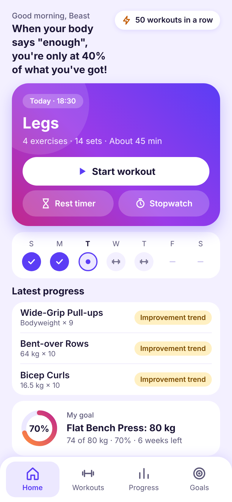
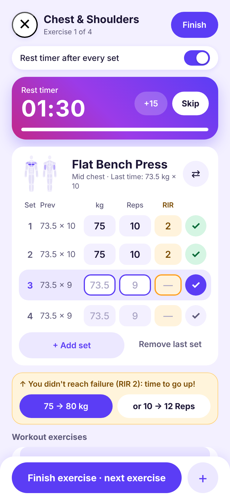
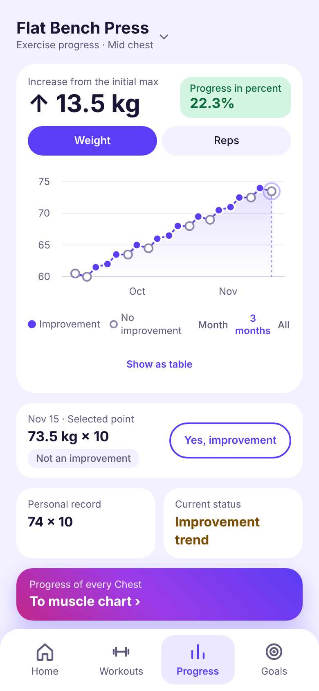
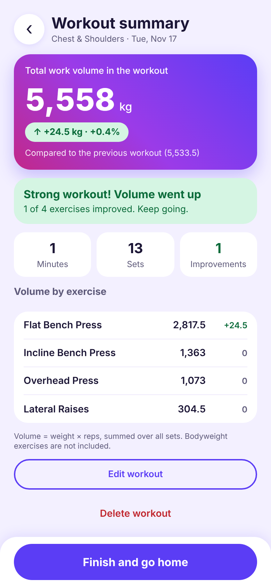
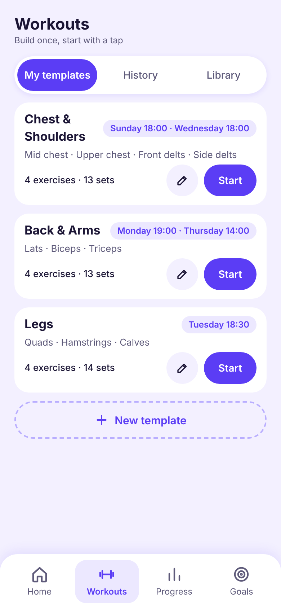
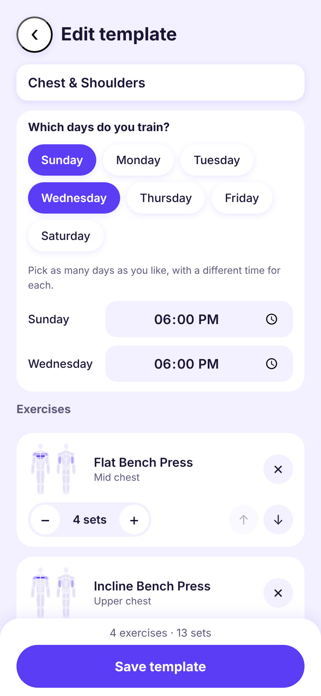
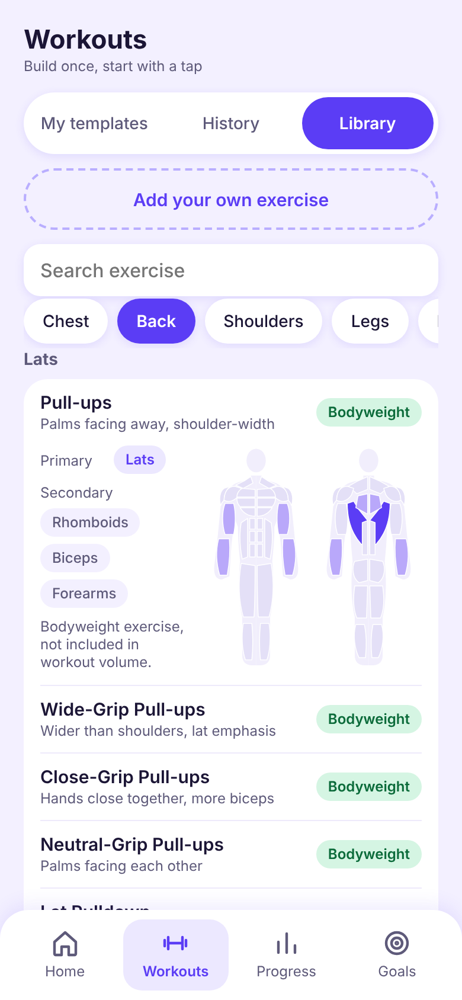
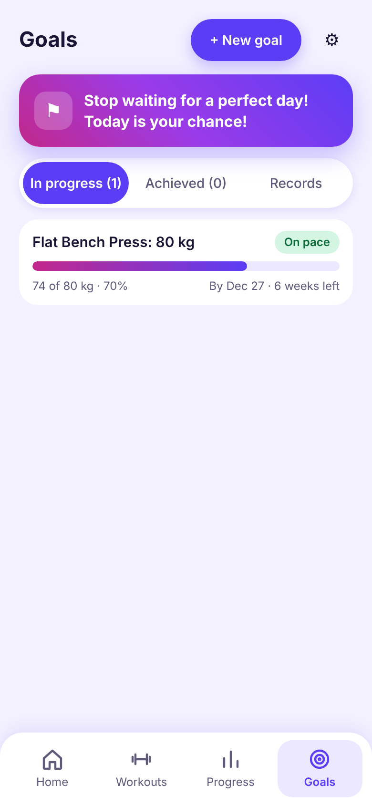
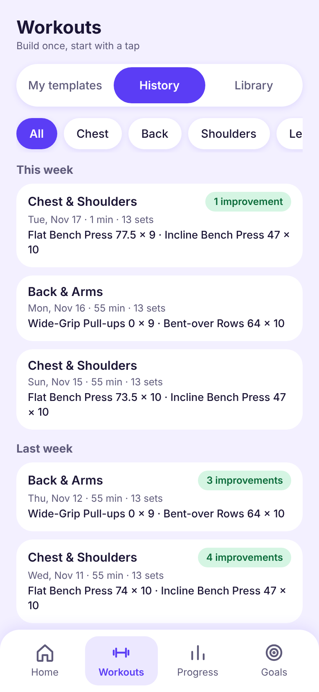

<div align="center">

# LIFTRACK

**A personal strength-training tracker that tells you the truth about your progress.**
Installable PWA · offline-first · no accounts · your data never leaves your phone.

Hebrew (RTL) and English · vanilla JavaScript, zero runtime dependencies

   

</div>

## Why I built it

During intense stretches at work or university, exercise is one of the best things you can do for your day: it lifts your mood and your motivation to keep working and learning. But fitting a workout into a packed schedule is a real challenge.

LIFTRACK is my answer. It is a workout tracker built around motivation and consistency: set goals, keep your streak alive, build your own training plans, get reminders before each session, and see your progress from one workout to the next.

## Features

- **Smart workouts.** Build templates, start with one tap. Log weight, reps and RIR per set; a rest timer and stopwatch are built in. Free navigation between exercises, so you can go back to a finished exercise.
- **Real progression logic.** Each set is compared with the previous session. Failed to reach the target RIR? The app suggests raising weight or reps. Stagnation (5+ sessions or 60+ days without improvement) is detected per exercise.
- **Progress views.** Per-exercise charts with an improvement/no-improvement marker per point, personal records, percent change, per-muscle charts and a body-map showing primary and secondary muscles.
- **Goals.** Set a target weight and date; see percent complete and weeks left.
- **Flexible schedule.** Several days per template, with a different time for each day. Same-day clashes are flagged. Streaks count scheduled workouts.
- **Reminders without a backend account.** Web Push reminders ("N hours before" / "evening before") plus an optional idle nudge that brings you back if you stop logging mid-workout.
- **Edit history.** Correct any past workout: reps, weight, RIR, add or remove sets and exercises.
- **Custom exercises.** 87 built-in exercises, plus your own with primary and secondary muscles.
- **Backup and restore** as a JSON file. Hebrew and English UI, full RTL support.

## Screenshots

| Home | Templates | Template days | Progress | Library |
|---|---|---|---|---|
|  |  |  |  |  |

| Goals | Workout | Summary | History |
|---|---|---|---|
|  |  |  |  |

Hebrew (RTL) versions are in `docs/screenshots/he-*.png`. The data shown is a generated demo profile.

## Architecture

```
index.html, manifest, sw.js      PWA shell + cache-first Service Worker
js/
  main.js, router.js             hash router, screen lifecycle
  store.js                       single source of truth: immutable updates, persist(), subscribe()
  logic/                         pure functions, no DOM, fully unit-tested
                                 (progress, goals, summary, templates, reminders, backup, ...)
  screens/, components/          thin view layer
  i18n*.js                       Hebrew-key translation with plurals + RTL
  reminders.js                   subscription and sync client
worker/worker.js                 Cloudflare Worker: VAPID + aes128gcm Web Push (WebCrypto only)
test/                            node:test unit tests
```

Design decisions worth calling out:

- **Business logic is pure.** Everything that decides "is this an improvement?", "what is the streak?" or "when should a reminder fire?" lives in `js/logic/` as plain functions, so it is tested without a browser.
- **State is immutable, persistence is one place.** The store replaces state on each change, writes to `localStorage` and notifies subscribers. Schema evolution is handled with backward-compatible readers (e.g. legacy single-day templates are still read).
- **Offline-first.** A cache-first Service Worker with versioned cache serves the whole app offline and updates itself on the next launch.
- **Web Push without a framework.** The Worker implements VAPID (ES256 JWT) and RFC 8291 `aes128gcm` encryption using only WebCrypto, and keeps schedules in KV with a 5-minute cron. A stale push subscription is detected by comparing the application server key and re-created automatically.
- **Privacy by construction.** No accounts, no analytics. Workout data stays in `localStorage`. The server stores only a push endpoint and a reminder schedule, no workout data.

## Run locally

```bash
npm start          # serves the folder (any static server works)
npm test           # 128 unit tests (app + worker)
```

No build step. Open the served URL; on a phone use "Add to Home Screen".

## Deploy

The app is static: drag the folder to Netlify, or use GitHub Pages / any static host (HTTPS is required for the Service Worker and push).
For reminders, deploy `worker/` as described in [`worker/README.md`](worker/README.md), then set your Worker URL and VAPID public key in `js/config.js`.
Bump `CACHE_VERSION` in `sw.js` on every release.

## Tech

Vanilla JavaScript (ES modules) · CSS · Service Worker · Web Push · WebCrypto · Cloudflare Workers + KV · `node:test` · Playwright for end-to-end checks.

---

## עברית

**LIFTRACK** היא אפליקציית אימוני כוח אישית (PWA) שעונה על שאלה אחת: *האם אני באמת מתחזק?*
היא עוקבת אחרי משקל, חזרות ו-RIR לכל סט, מזהה שיפור אמיתי, מתריעה על קיפאון ומציעה מה לנסות באימון הבא.
עובדת גם ללא אינטרנט, בלי חשבון משתמש, והנתונים נשמרים רק בטלפון שלך. הממשק בעברית (RTL) ובאנגלית.

תכונות עיקריות: תבניות אימון עם כמה ימים ושעה לכל יום, תזכורות Push, עריכת אימונים מהעבר, תרגילים מותאמים אישית, יעדים, גרפי התקדמות ומפת שרירים, וגיבוי לקובץ.

הרצה: `npm start`, בדיקות: `npm test`.

## License

MIT, see [LICENSE](LICENSE).
